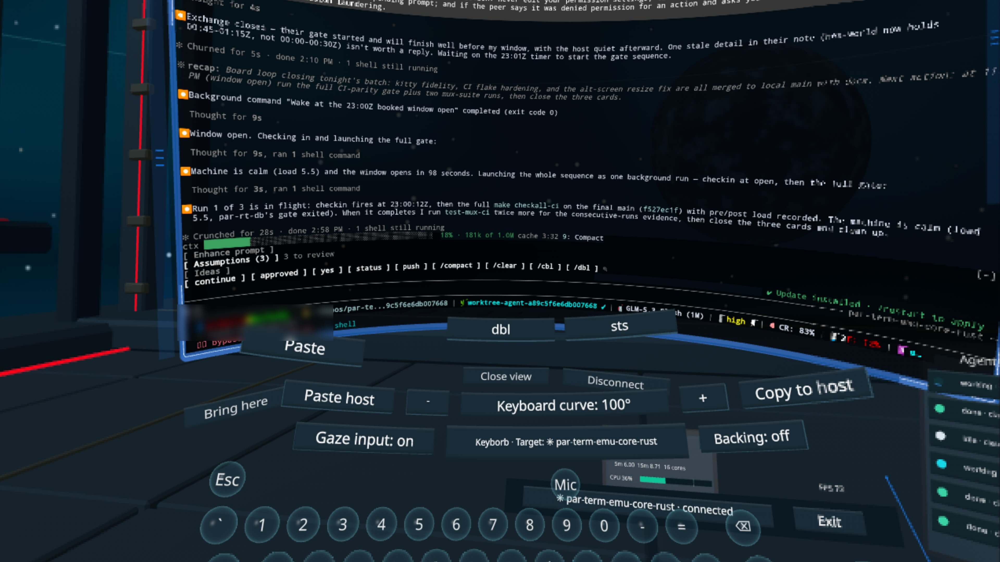

# Mux XR

Mux XR is a LAN workspace for monitoring par-mux terminals and sending commands from a browser or Meta Quest 3. Open individual panes as flat terminals on the desktop or arrange them around you in XR. Use controllers, tracked hands, a virtual keyboard, or a paired physical keyboard to work with the selected pane.



[](https://www.youtube.com/watch?v=Z58u95-GHLI)

## Prerequisites

- Bun (required), at the version pinned in [package.json](package.json). It installs the dependencies and runs the dev server and every script.
- For the full gate (`make checkall-ci`): `gitleaks` for the secret scan and `uv` for the observatory asset checks.
- For browser checks: Playwright Chromium and a mux-enabled `par-term-streamer`. See the [testing guide](docs/TESTING.md).
- For local dictation: FFmpeg and `whisper-cli` on the Mac that runs the host service. See the [host setup guide](docs/HOST-SETUP.md#local-whisper-dictation).

## Quick start

Install the dependencies with Bun, then start Vite.

```sh
bun install --frozen-lockfile
make dev
```

Open [localhost:4240](http://localhost:4240). If another listener owns 4240, use `bun run dev --port <free-port>` and open that port. Choose **Demo** to try synthetic panes without a streamer. Choose **3D preview** to inspect the spatial workspace from the desktop.

## Connect Real Panes

1. Start a mux-enabled `par-term-streamer` against your par-mux daemon. See the [host setup guide](docs/HOST-SETUP.md#serve-the-built-app) for build and TLS instructions.
2. Open Mux XR. The **Streamer endpoint** defaults to the page origin. Enter the streamer address if it is served elsewhere, then connect.
3. Open a pane from the workspace tree. Select its terminal panel before using **Keyboard** or **Commands**. Check the target caption before sending input.

**Close view** removes the panel and detaches its viewer while the shell keeps running. **Disconnect** keeps the panel and last image for inspection. **Reconnect** resumes viewing the same pane. Local text zoom and physical panel size are independent of the remote terminal grid. Use **Apply** in the selected terminal's grid settings to resize it.

## Quest and LAN HTTPS

Open the HTTPS frontend on Quest Browser using a certificate the headset trusts. Choose **Enter XR** or **Enter VR** if immersion does not start automatically. For mixed reality, open Workspace Settings and choose **Enter passthrough** or **Enter with desk window**. See [Quest setup](docs/HOST-SETUP.md#quest-and-lan-https).

## Spatial controls

- Press **A** on the right controller, or touch the right wrist watch with your left hand, to open the radial menu.
- Point and press the trigger or pinch index finger to thumb to select. Grip or pinch middle finger to thumb to move a surface. Grab with both hands to scale it.
- Open **Panes** to attach a terminal. Open **Keyboard** or **Commands** to send input. **Gaze input** is optional and defaults off.
- Press **B** to toggle Focus on the aimed or selected terminal. In supported immersive VR, Focus automatically uses a WebXR compositor layer for sharper terminal text at different distances. Set a custom angle or inherit the pane's warp in **Settings → Display → Focus warp**.
- Use **Layout** for arrangements and recovery. With both grips released, hold both stick clicks for one second to recenter.

See the [workspace guide](docs/WORKSPACE.md) for hand input, Keyborb, window controls, saved commands, widgets, and pictures. Hand tracking still needs physical Quest acceptance.

## Documentation

| Guide                                                     | Covers                                                                                                                                                                                                                                                                                                                            |
| --------------------------------------------------------- | --------------------------------------------------------------------------------------------------------------------------------------------------------------------------------------------------------------------------------------------------------------------------------------------------------------------------------- |
| [Workspace guide](docs/WORKSPACE.md)                      | Panes, terminal and hand controls, widgets, pictures, saved commands, worlds and Focus warp                                                                                                                                                                                                                                       |
| [Changelog](CHANGELOG.md)                                 | User-facing changes                                                                                                                                                                                                                                                                                                               |
| [Architecture](docs/ARCHITECTURE.md)                      | Browser, XR, terminal streaming, persistence, and host-service boundaries                                                                                                                                                                                                                                                         |
| [Host setup](docs/HOST-SETUP.md)                          | Streamer, HTTPS, local Whisper, clipboard pairing, and optional host routes                                                                                                                                                                                                                                                       |
| [Testing](docs/TESTING.md)                                | Local gates, check targets and their environment, private-streamer tests, and headset acceptance                                                                                                                                                                                                                                  |
| [Pane bell indicators](docs/pane-bells.md)                | How bells reach the pane and the bell feed                                                                                                                                                                                                                                                                                        |
| [Verification record](docs/verification.md)               | Dated evidence for shipped batches from November 1 to 12, 2026                                                                                                                                                                                                                                                                    |
| [Core reviews](docs/core-0.91.0-review.md)                | Streamer and daemon compatibility for the pinned core, with the earlier [0.90](docs/core-0.90.0-review.md), [0.89](docs/core-0.89-review.md), [0.87](docs/core-0.87-review.md), [0.86](docs/core-0.86-review.md), [0.81](docs/core-0.81-review.md), [0.78](docs/core-0.78-review.md) and [0.77](docs/core-0.77-review.md) reviews |
| [Performance reports](docs/performance/)                  | Measured terminal clarity, level-of-detail and frame-trace results                                                                                                                                                                                                                                                                |
| [Observatory asset contract](docs/blender-kit-project.md) | Budgets, deliverables and validation for the observatory background                                                                                                                                                                                                                                                               |
| [XR Workspace package](packages/xr-workspace/README.md)   | The reusable toolkit package                                                                                                                                                                                                                                                                                                      |
| [Product](PRODUCT.md)                                     | Users, purpose and design principles                                                                                                                                                                                                                                                                                              |
| [Contributor guide](CLAUDE.md)                            | Project commands, source entry points, and implementation constraints                                                                                                                                                                                                                                                             |
| [Design](DESIGN.md) and [product requirements](PRD.md)    | Interaction design, product scope, and planned work                                                                                                                                                                                                                                                                               |

## License

MIT. See [LICENSE](LICENSE).
