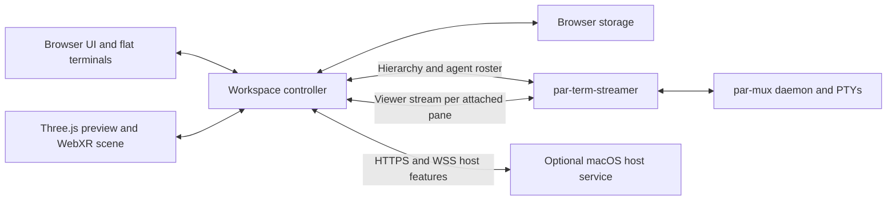

# Mux XR architecture

Mux XR is a browser client for par-mux. The browser owns presentation, input selection, and device-local state. The par-mux daemon owns sessions, panes, shell processes, and PTY grids. The mux-enabled par-term-streamer bridges the browser and daemon. An optional macOS companion serves local features such as dictation and clipboard pairing.

## Workspace and presentation

[main.ts](../src/main.ts) wires up the streamer endpoint, hierarchy snapshot, active input target, and map of attached terminal surfaces. The [shared contracts](../src/contracts.ts) define workspace actions and terminal surfaces. Selecting a pane attaches its surface on demand, updates the active target, and synchronizes both presenters.

- [Browser UI](../src/ui/index.ts) renders the hierarchy, settings, and input drawer. [Desktop panels](../src/desktop/panels.ts) display flat terminal canvases. The 3D preview adds spatial interaction while keeping input in the browser drawer.
- [XR entry](../src/xr/entry.ts) coordinates session startup and browser activation. The [Three.js scene](../src/xr/scene.ts) owns native panels, controller and hand input, manipulation, rendering, and session cleanup. VR uses an immersive VR session. Full passthrough and Desk Window use immersive AR. Desk Window requires alpha blending and reveals passthrough within its frame.
- [Keyboard routing](../src/keyboard-router.ts) and [quick commands](../src/quick-commands.ts) use the same target selection as the UI. [Dictation](../src/speech-input.ts) captures the target when recording starts and requires explicit insertion of the reviewed transcript. Changing the target clears keyboard modifiers and cancels pane-bound dictation. Gaze-based keyboard targeting is opt-in and independent of gaze-based rendering.

## Streamer and terminal lifecycle

The [hierarchy client](../src/workspace/hierarchy.ts) opens `/ws?metadata=1`, requests the tree, and receives hierarchy snapshots and agent roster updates. It normalizes workspace → session → window → pane data for both presenters. Metadata browsing is independent of terminal viewer connections.

Each [terminal surface](../src/terminal/surface.ts) opens a viewer connection at `/ws?session=pane-<id>`. The [protocol adapter](../src/terminal/protocol.ts) uses the [vendored protobuf binding](../src/terminal/vendor/terminal_pb.ts) and a compression flag for raw or zlib payloads, with a 9 MiB bound. [core-release.json](../core-release.json) records the upstream revision and artifact hashes. The [core 0.81 review](core-0.81-review.md) records compatibility evidence for that pin.

The streamer supplies terminal state and dimensions at attach, then sends output, updates, and process lifecycle events. The surface uses xterm.js to maintain the terminal model and supplies its canvas, status, and input methods to both presenters. Connection status and [process state](../src/terminal/lifecycle.ts) are separate. For example, an exited shell can still have an attached viewer.

The surface rejects input when disconnected and reconnects after transient loss without replaying unsent input. Manual disconnect retains the view and stops retries. Closing the view disposes its browser surface and socket. Explicit grid Apply sends a resize and adopts the server's reported dimensions. An explicit **New terminal** action uses the [pane-create client](../src/workspace/pane-create.ts). The streamer must permit creation, and the client reconciles the hierarchy before allowing a retry after an ambiguous result.

## Terminal rendering

The [canvas painter](../src/terminal/painter.ts) compares visible cells and repaints changed rows, including cursor damage. Desktop shows this canvas directly. XR maps it onto a flat or curved mesh. The [texture updater](../src/xr/terminal-texture.ts) uses changed strips for eligible updates and falls back to a full upload when needed.

[Distance-based detail](../src/xr/terminal-lod.ts) reduces raster resolution and paint cadence for distant panes. The looked-at pane returns to full quality. Hidden panes keep parsing output, and desktop views return to full raster quality. The [terminal material](../src/xr/terminal-material.ts) owns sampling and glass treatment. The PTY grid, input target, and native UI labels stay independent of those rendering choices.

[XR labels](../src/xr/labels.ts) use self-hosted Noto fonts through Troika SDF, with main-thread typesetting under the streamer's CSP. The [widget registry](../src/xr/widget-registry.ts) defines widget types and default placement. The [environment manager](../src/environment.ts) loads and disposes scene backgrounds.

## Persistence and updates

- [Browser settings](../src/ui/index.ts) validate and persist device preferences. [Open views](../src/workspace/open-views.ts) save the selected pane and open views per streamer. On reconnect or reload, saved pane identities resolve against the live hierarchy before attaching.
- [Quick commands](../src/quick-commands.ts), [pane appearance](../src/xr/terminal-warp-store.ts), [input panel poses](../src/xr/ui-poses.ts), and [widget poses](../src/xr/widget-poses.ts) have their own local stores. Focus is temporary unless the user explicitly keeps the pane's placement.
- The [picture controller](../src/workspace/pictures.ts) owns the common browser/XR loading path. [Picture storage](../src/xr/picture-store.ts) keeps current frames and Recent images in separate IndexedDB stores. [HEIF decode](../src/xr/heif-decode.ts) uses a worker. Optional [depth estimation](../src/server/depth-estimator.ts) runs on the Mac, while the [picture frame](../src/xr/picture-frame.ts) renders depth and stereo views.

Vite builds the static frontend into `dist/`. The [build plugin](../scripts/build-version.ts) embeds a fingerprint and emits `version.json` from bundle and public assets. The [update checker](../src/update-check.ts) polls the same origin. A changed build can reload the desktop automatically. In immersion the user confirms the reload, and the [reload helper](../src/reload.ts) ends the XR session before navigating. The streamer and remote shells continue running.

## Optional host service

[scripts/dictation-server.ts](../scripts/dictation-server.ts) starts an HTTPS service, conventionally on port 4242. Its [route dispatcher](../src/server/dictation-server.ts) handles local Whisper dictation and the optional companion features. Terminal streams stay on the streamer even when the companion is running.

| Feature | Host boundary |
| --- | --- |
| Dictation | The browser records bounded audio. `/dictate` checks the frontend origin and runs local FFmpeg and Whisper. |
| Clipboard and toasts | `/clipboard` accesses the logged-in user's pasteboard. Paired headsets subscribe to `/toasts`. Programs post to `/toast` with a bearer secret. |
| Pictures | Opt-in `/picture-fetch` fetches public image URLs with bounded transfers. Opt-in `/picture-depth` estimates depth for uploaded images. |
| Host widgets | `/host-stats` reports load. Optional repo, kanban, booking, service-health, and mesh feeds return limited read-only summaries. `/weather` supplies the US ZIP forecast. |

Paired WebSocket routes use the clipboard pairing secret with route-specific challenge-response. Credentials for upstream services stay on the host. The [host setup guide](HOST-SETUP.md) covers available flags, TLS, and the launchd modes.

See [Testing](TESTING.md) for the distinction between browser fixtures, private real-streamer checks, and Quest acceptance.
